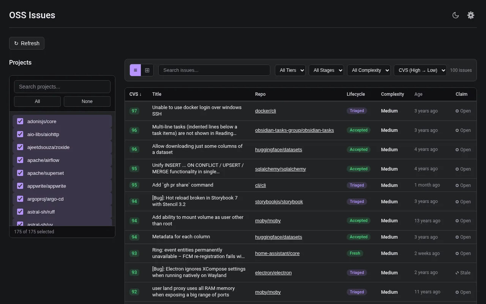

# OSS Issue Aggregator

The aggregator is the scoring and API layer of a small pipeline for finding
open-source issues worth assigning a contributor to, live at
[hadoku.me/aggregator](https://hadoku.me/aggregator). A companion scraping
service collects issue, pull-request and repo data from the forges it
watches; this repo reads that data, scores it, and serves the result — to its
own page, and to any other tool that calls its API.

Scoring combines a repo's health (is it maintained, is a merge realistic),
an issue's own signals (freshness, activity, how clear it is, how much
competition it has) and whether anyone has already claimed it into one 0–100
**Contribution Viability Score**. The page itself is read-only for anyone who
opens it; claiming an issue, or anything else that writes, needs a signed-in
friend tier or above.

- [Features](features.md): what each part does and how to use it.
- [Contributing](contributing.md): running it locally, how it is built, how it deploys.
- [History](history.md): from a static dashboard to a scored, multi-repo pipeline.
- [Trivia](trivia.md)

## Trivia

The repo health score, the issue viability score, lifecycle classification
and sentiment analysis — the whole engine the app is named for — shipped in
a single commit ([history](history.md#the-recon-pipeline-february-2026)).
